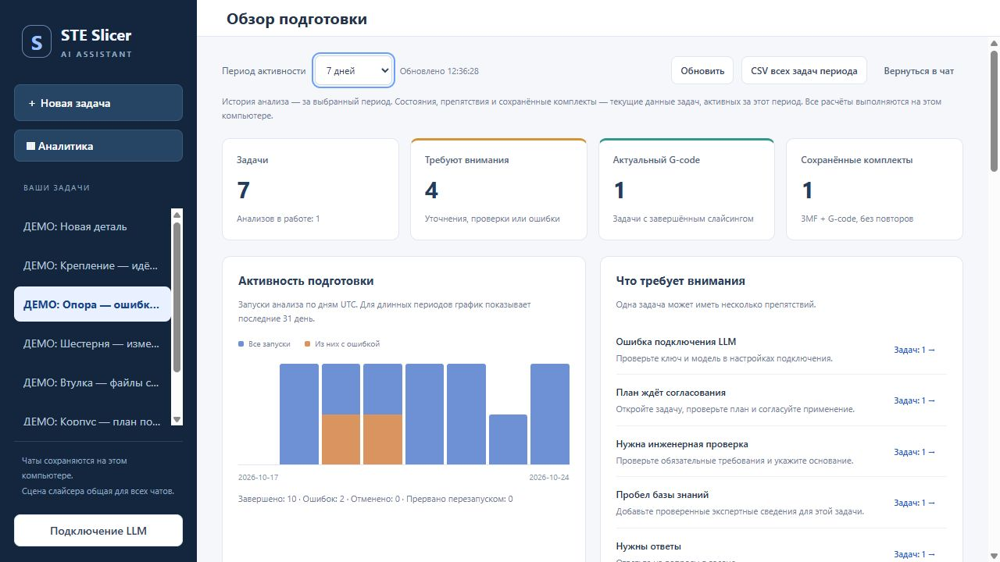

# Аналитика подготовки

Экран **«Аналитика»** в левой панели работает с локальной историей. Он не запускает
LLM, расчёт G-code или изменение сцены. Чтобы продолжить работу, нажмите название
задачи в таблице либо «Вернуться в чат»; набранный текст остаётся в черновике.

## Период и показатели

Период — последние 7/30 × 24 часа либо всё время. Границы и дни графика — UTC;
семидневное окно может пересекать восемь календарных дат. Задача входит в отчёт,
если в периоде обновлена либо содержит запуск/событие за период. История анализов,
вызовов и ошибок отбирается по времени; текущие состояния и сохранённые комплекты
относятся ко всей выбранной группе задач. График ограничен последними 31 днями.

| Показатель | Что означает |
| --- | --- |
| Требуют внимания | Задачи с вопросами, необходимыми допущениями/проверками, противоречиями, блокирующими неизвестными, устареванием, ожиданием согласования, последним пробелом базы или текущей ошибкой |
| Завершённый анализ | Принят структурированный ответ. Возможны незакрытые вопросы; это не готовность G-code |
| Актуальный G-code | Завершённый расчёт применённого согласованного плана; версия требований и снимок совпадают, процесс тот же. Устаревание отслеживает штатный мост сцены |
| Оценки печати | По последнему актуальному расчёту на задачу. Время в часах из секунд; материал суммируется только в одинаковых исходных единицах |
| Сохранённые комплекты | Подтверждённая успешная запись непустых project.3mf и result.gcode. Повторы одного расчёта считаются один раз; partial, stale и пустые файлы исключены |
| HTTP-попытки LLM | Анализ и проверка подключения, включая повторы 429/5xx. Ошибки без отправленного HTTP-запроса сюда не входят |
| Токены | Значения usage API, с числом ответов, где известен total. При отсутствии total он выводится только из известных prompt + completion |
| Длительность анализа | От постановки запуска до завершения, включая очередь и импорт; только завершённые запуски |
| Длительность инструмента | Время вызова MCP, включая ожидание. Для start_slicing — только постановка backend в работу; это не длительность всего слайсинга |
| Медиана / p95 | Ближайший ранговый процентиль известных неотрицательных длительностей. Для инструментов показано число замеров |

Нет данных отличается от измеренного нуля. Невалидные, отрицательные и бесконечные
значения отбрасываются. Старая история не содержит метрик LLM; задержки прежних
инструментов восстанавливаются по паре событий, если это возможно. Неполные
токены — учтённая часть использования, а не полная сумма счёта провайдера.
Стоимость, экономия, прочность и качество физической печати не вычисляются.
Сохранённый комплект — историческое подтверждение записи; файлы не перечитываются
с диска, поэтому последующее внешнее удаление не отражается в этом счётчике.

## Фильтры и CSV

Поиск по названию, фильтры внимания/результатов/комплектов и страницы по 25 задач
работают в таблице. Кнопка в блоке препятствий показывает связанные задачи.
Смена поиска или фильтра снимает отбор по конкретному препятствию.
**«CSV всех задач периода»** выгружает весь период независимо от фильтров таблицы:
UTF-8 с BOM, разделитель `;`, корректное экранирование многострочных полей и
защита текстовых ячеек от выполнения формул при открытии в Excel.

JSON и CSV используют прежнюю проверку Host, Origin и X-Assistant-Token.
Отчёт содержит название/ID задачи, счётчики, коды, состояния и агрегаты; в него
не включаются тексты сообщений, запросы LLM, изображения, пути файлов, аргументы
или полные ответы инструментов. Известный API key дополнительно редактируется.
Отчёт строится под согласованным снимком хранилища, не изменяя историю.

## Проверка

`tests/test_analytics.py` проверяет агрегацию, границы периодов, старую историю,
нулевые и отсутствующие значения, повторы, длительности, актуальность результатов,
комплекты, препятствия, CSV и авторизацию. HTTP/MCP настоящие локальные; ответы
провайдера и слайсер — тестовые. Скриншот выше получен на отдельном стенде
с явно подписанными синтетическими задачами. Он не доказывает работу backend,
лицензии или физической печати в STE Slicer.
